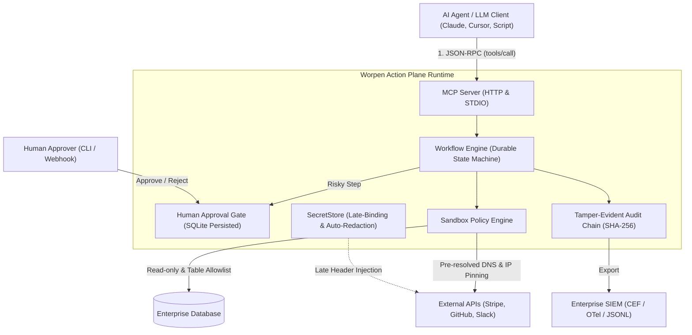

# Worpen: The Action Plane for AI Agents

[](https://github.com/matinsanei/worpen/actions)
[](https://modelcontextprotocol.io/)
[](https://www.rust-lang.org/)
[](THREAT_MODEL.md)
[](LICENSE)

> **North Star:** An agent completes a real multi-step job in one call, never sees a credential, can only do what policy allows, risky steps pause for human approval, and every action is provably recorded.

Worpen sits between autonomous AI agents (Claude, Cursor, OpenAI Agents, custom harnesses) and your enterprise systems. Instead of handing an LLM raw API credentials and database access, you give it policy-governed tools that execute multi-step workflows deterministically in milliseconds.

---

## Why Worpen?

Every MCP server today is an isolated island: one talks to PostgreSQL, one sends emails, one touches Stripe. To accomplish a business task (*"Issue refund for order #1042 and notify the customer"*), an LLM must orchestrate 5+ tool calls itself—burning context window tokens, multiplying latency, and seeing plaintext credentials at every hop.

```
BEFORE: Unsandboxed LLM Round-Trips (High Risk)
  LLM ──(sees raw password)──► Database Lookup
  LLM ──(manual math)────────► Calculate Net Refund
  LLM ──(sees Stripe token)──► Stripe API Mutation
  LLM ──(sees SMTP auth)─────► Email Notification
  * Risky actions execute without human confirmation; zero tamper-evident audit.

AFTER: Worpen Action Plane (Enterprise Safe)
  LLM ──(1 MCP Tool Call)───► Worpen Action Plane
                               ├─ SQL Query (Table allowlist & read-only guard)
                               ├─ Calculation (Bounded transform)
                               ├─ Approval Gate (Pauses if amount > $50)
                               ├─ Outbound API (Credentials injected late, IP pinned)
                               └─ Provenance Log (Tamper-evident SHA-256 chain)
  * LLM never sees a credential. Risky operations pause for human review.
```

---

## 60-Second Quickstart

### 1. Build and Run

```bash
# Build binary
cd backend && cargo build --release --bin worpen
cd ..

# Verify environment diagnostics
./backend/target/release/worpen doctor
```

### 2. Scaffold a Project

```bash
# Initialize project with production starter templates
./backend/target/release/worpen init my-action-plane
cd my-action-plane
```

### 3. Run the Refund Demo with Human Approval

Worpen comes with a production refund workflow (`workflows/refund.yaml`) featuring a human approval gate:

```bash
# Start the runtime
worpen serve &

# 1. Register the workflow
worpen workflow register --file workflows/refund.yaml

# 2. Agent triggers the refund ($75.00) — automatically pauses at approval gate!
worpen workflow run --name refund --payload '{"customer_id": "cust_99", "amount": 75.0, "reason": "Damaged goods"}'
# => Status: WaitingForApproval | Run ID: 4f1a2b...

# 3. List runs waiting for human operator review
worpen workflow pending

# 4. Human approves the run from CLI
worpen workflow approve --run-id 4f1a2b... --approver "sarah_manager" --reason "Confirmed receipt of damaged item"
# => Status: Completed | Result: {"refund_status": "approved_and_processed", "amount": 75.0}

# 5. Provably verify the cryptographic audit trail
worpen audit verify
# => ✓ Cryptographic Audit Trail Valid: 3 entries verified. Genesis: 00000000...
```

---

## Architecture Overview



---

## Security Model & Sandboxing

| Layer | Mechanism | Protection Guarantee |
| :--- | :--- | :--- |
| **Credentials** | `{{secret:name}}` Late-Binding & Multi-Encoding Redaction | Secrets are never registered in symbol tables or memory visible to agents. Automatically redacted to `[REDACTED]` across raw plaintext, Base64, Hexadecimal, and URL percent-encoding. |
| **Network & SSRF** | Deny-by-Default, Pre-Flight DNS & Socket IP Pinning | Deny-by-default (`allow_net: false`). Empty allowlist rejects all outbound traffic. Blocks private RFC 1918 IPs, loopback (`127.0.0.1`), cloud metadata (`169.254.169.254`), CGNAT, and IPv4-mapped IPv6 with pinned outbound sockets. |
| **Database** | Tokenized Sanitization, Table Allowlist & SQLite `PRAGMA query_only` | Sanitizes comments and strings; denies all DDL/DML mutations across the token stream (blocking CTE & subquery bypasses). Enforces multi-table comma joins allowlists and activates SQLite C-engine `PRAGMA query_only = ON;`. |
| **Approvals** | Dedicated Operator Channel & Anti-Self-Approval | Approval gates can NEVER be approved via agent MCP tools (`APPROVAL_CHANNEL_SEPARATION`). Approvals strictly require operator CLI (`worpen workflow approve`) or authenticated management REST endpoints. Initiators are strictly forbidden from self-approving runs. |
| **Audit Log** | HMAC-SHA256 Keyed Cryptographic Chaining | Every action links cryptographically to the previous entry hash and is signed with a secret HMAC key (`WORPEN_AUDIT_KEY`). Verifiably tamper-evident against unauthorized log tampering, truncation, or recomputation. |

For detailed architectural analysis, read our formal [Threat Model (THREAT_MODEL.md)](THREAT_MODEL.md).

---

## Model Context Protocol (MCP) Setup

Worpen provides native MCP support over both **HTTP** (`POST /mcp`) and **STDIO** (`worpen mcp serve-stdio`).

### Claude Desktop Configuration
Add Worpen to your `claude_desktop_config.json`:

```json
{
  "mcpServers": {
    "worpen": {
      "command": "worpen",
      "args": ["mcp", "serve-stdio"],
      "env": {
        "DATA_DIR": "./data",
        "DATABASE_URL": "sqlite:worpen.db?mode=rwc"
      }
    }
  }
}
```

### Cursor & VS Code
Ready-to-use configurations are located in `clients/`:
- `clients/claude_desktop_config.json`
- `clients/cursor_mcp.json` (and `.cursor/mcp.json`)
- `clients/vscode_mcp.json`

### Tool Risk Annotations & Agent Error Envelopes
Every exposed tool includes standard MCP hints (`readOnly`, `destructive`, `idempotent`). Errors return structured recovery guidance:

```json
{
  "code": "APPROVAL_REQUIRED",
  "message": "Action paused at approval gate for run '4f1a2b...': Approve refund of $75.00",
  "hint": "A human operator must approve this run before execution can proceed. Use tool 'approve_run'",
  "retryable": true,
  "fields": {
    "run_id": "4f1a2b..."
  }
}
```

---

## Workflow Specification (`v1`)

Workflows are written in human-readable, declarative YAML:

```yaml
name: customer_refund
version: "1.0.0"
description: Issue refund with human gatekeeper
input_schema:
  type: object
  properties:
    customer_id: { type: string }
    amount: { type: number }
  required: [customer_id, amount]

policy:
  read_only_sql: false
  allowed_tables: [refunds]
  block_private_ips: true
  allowed_hosts: [api.stripe.com]

steps:
  - id: check_amount
    op: transform
    expr: "{{amount}} * 1.0"
    output_var: formatted_amount

  - id: manager_gate
    op: approval
    summary: "Approve refund of ${{formatted_amount}} for customer {{customer_id}}"
    timeout_seconds: 86400

  - id: issue_stripe_refund
    op: http
    method: POST
    url: "https://api.stripe.com/v1/refunds"
    headers:
      Authorization: "Bearer {{secret:STRIPE_SECRET_KEY}}"
    body:
      amount: "{{formatted_amount}}"
    output_var: stripe_res

  - id: record_database
    op: sql
    query: "INSERT INTO refunds (customer, amount, approved_by) VALUES ($1, $2, $3);"
    args: ["{{customer_id}}", "{{formatted_amount}}", "{{__approved_by}}"]
    output_var: db_res

return:
  status: 200
  value:
    refund_status: "completed"
    stripe_id: "{{stripe_res.id}}"
    approved_by: "{{__approved_by}}"
```

---

## Command Line Interface (CLI)

```bash
# Project & Health
worpen init [path]               # Scaffold a new project with starter templates
worpen doctor                    # Run complete system & sandbox diagnostics
worpen test --file wf.yaml       # Validate schema & dry-run simulate with mock inputs
worpen serve --port 3000         # Launch the action plane runtime

# Workflow Management
worpen workflow list             # List registered workflows
worpen workflow register -f file # Register/update a workflow definition
worpen workflow run --name wf    # Execute workflow (supports --dry-run)
worpen workflow pending          # List runs waiting for human approval
worpen workflow approve --run-id # Approve a paused run and resume execution
worpen workflow reject --run-id  # Reject a pending run

# Tamper-Evident Audit
worpen audit verify              # Verify SHA-256 hash-chain integrity
worpen audit export --format cef # Export audit trail in CEF, JSONL, or OTel
```

---

## Docker Deployment

A hardened multi-stage Dockerfile is included:

```bash
docker build -t worpen:latest .
docker run -p 3000:3000 -v $(pwd)/data:/data -v $(pwd)/secrets:/secrets:ro worpen:latest
```

---

## Verifiable Benchmarks

All benchmark figures in this repository are derived from reproducible Criterion harnesses located in `backend/crates/core/benches/`.

```bash
cd backend
cargo bench --bench comprehensive_benchmark
```

*Worpen avoids publishing synthetic cross-language comparisons against unoptimized mock servers. Performance claims are backed strictly by in-repo benchmarks on standard hardware.*

---

## Contributing & Security

- **Vulnerability Disclosure:** Please review our [Security Policy (SECURITY.md)](SECURITY.md). Never open public issues for security vulnerabilities.
- **Architecture Decisions:** Read our architectural decision log in [DECISIONS.md](DECISIONS.md).
- **License:** [MIT](LICENSE) © Matin Sanei
